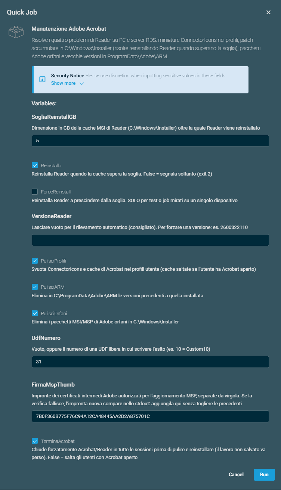
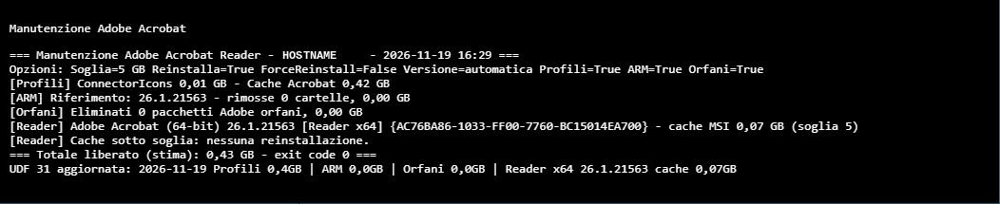
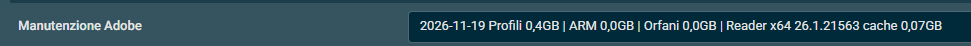

# Adobe-Reader-Maintenance

🇬🇧 [English version](README.md)

Script PowerShell che recupera lo spazio disco occupato da Adobe Acrobat Reader su postazioni Windows e server RDS. Può essere eseguito **standalone**, come **attività pianificata** oppure come **component Datto RMM**.

> ⚠️ **Le cancellazioni sono definitive, Acrobat/Reader viene chiuso forzatamente in tutte le sessioni (con `TerminaAcrobat=true` il lavoro non salvato va perso) e lo script può disinstallare/reinstallare Reader in automatico.** Provalo prima su una singola macchina e schedulalo fuori orario.

## Cosa fa

0. **Chiusura di Acrobat/Reader** (se `TerminaAcrobat=true`)
   - Chiude forzatamente Acrobat/Reader e i processi di servizio in tutte le sessioni, all'avvio e di nuovo subito prima della reinstallazione. I file aperti impediscono pulizia e disinstallazione. Gli utenti coinvolti sono riportati nell'output.
1. **Profili utente**
   - Svuota `AppData\LocalLow\Adobe\Acrobat\DC\ConnectorIcons` (bug Adobe: le miniature non vengono mai eliminate e possono arrivare a diversi GB per utente).
   - Svuota le cache WebView2/AcroCef di Acrobat, **solo per gli utenti che non hanno ancora processi Acrobat/Reader attivi**.
2. **`C:\ProgramData\Adobe\ARM`**
   - Elimina le cartelle `Reader_*` / `Acrobat_*` di versioni inferiori a quella installata (tutte se nessun Acrobat/Reader è presente, né registrato né su disco).
   - Elimina le sottocartelle di `ARM\S` più vecchie di 30 giorni.
3. **MSI/MSP orfani di Adobe in `C:\Windows\Installer`**
   - Eliminati solo se non referenziati da alcun prodotto installato **e** identificati come Adobe Acrobat/Reader tramite Summary Information. Esclusi i file modificati nelle ultime 24 ore.
4. **Cache MSI di Reader (patch referenziate)**
   - Se la cache supera `SogliaReinstallGB` (o con `ForceReinstall`), Reader viene disinstallato e reinstallato: installer base MUI + ultimo aggiornamento scaricati da `ardownload2.adobe.com`, con **firma verificata prima della disinstallazione**: firma Authenticode valida, certificato di firma intestato ad Adobe (campo `O=`) e almeno un certificato intermedio/radice della catena con impronta presente nell'elenco autorizzato (`FirmaMspThumb`, `FirmaBaseX86Thumb`, `FirmaBaseX64Thumb`).
   - Solo per Reader (x86 `7AD7` o x64 unificato con `SCAPackageLevel=1`), un solo prodotto installato, nessun Acrobat aperto, nessuna installazione MSI in corso, spazio libero sufficiente. Acrobat Standard/Pro non viene mai toccato.
   - Versione dell'aggiornamento: `VersioneReader` se valorizzata, altrimenti rilevata da `armmf.adobe.com` (`current_version.txt`, manifest win e mac) con fallback su `VersioneRiserva`.

I prodotti sono rilevati dalla registrazione di Windows Installer (`Installer\UserData`), non dalle chiavi `Uninstall`, che possono essere danneggiate.

## Requisiti

- Windows 10/11 o Windows Server con **Windows PowerShell 5.1**.
- Esecuzione come **Amministratore** o **SYSTEM**.
- Per la reinstallazione: accesso HTTPS a `ardownload2.adobe.com` e `armmf.adobe.com` (se configurato, viene usato automaticamente il proxy dell'agent Datto RMM).

## Configurazione

Tutte le opzioni sono nel blocco **CONFIGURAZIONE** in cima allo script. Le variabili d'ambiente con lo stesso nome hanno la precedenza sui valori del blocco (è il meccanismo con cui Datto RMM passa le variabili del component).

| Variabile | Tipo | Default | Descrizione |
|---|---|---|---|
| `SogliaReinstallGB` | numero | `5` | Dimensione in GB della cache MSI di Reader (`C:\Windows\Installer`) oltre la quale Reader viene reinstallato |
| `Reinstalla` | bool | `true` | Reinstalla Reader quando la cache supera la soglia. `false` = solo segnalazione (exit 2) |
| `ForceReinstall` | bool | `false` | Reinstalla Reader a prescindere dalla soglia. **Solo per test o job mirati su un singolo dispositivo** |
| `TerminaAcrobat` | bool | `true` | Chiude forzatamente Acrobat/Reader in tutte le sessioni prima di pulire e reinstallare (il lavoro non salvato va perso). `false` = salta gli utenti con Acrobat aperto e rinvia la reinstallazione |
| `VersioneReader` | stringa | vuoto | Vuoto = rilevamento automatico (consigliato). Per forzare una versione: es. `2600322110` |
| `VersioneRiserva` | stringa | `2600322110` | Versione usata se il rilevamento automatico fallisce (solo nel blocco dello script) |
| `PulisciProfili` | bool | `true` | Pulizia di ConnectorIcons e cache Acrobat nei profili utente |
| `PulisciARM` | bool | `true` | Pulizia di `C:\ProgramData\Adobe\ARM` |
| `PulisciOrfani` | bool | `true` | Eliminazione dei pacchetti MSI/MSP Adobe orfani in `C:\Windows\Installer` |
| `UdfNumero` | stringa | vuoto | Vuoto = nessuna scrittura UDF. Numero di una UDF Datto RMM libera in cui scrivere l'esito (es. `10` = `Custom10`) |
| `SpazioMinimoGB` | numero | `3` | Spazio libero minimo sul disco di sistema per reinstallare (solo nel blocco dello script) |
| `FirmaMspThumb` | stringa | `7B0F360B775F76C94A12CA48445AA2D2A875701C` | Impronte dei certificati intermedi/radice autorizzati per l'aggiornamento MSP, separate da virgola |
| `FirmaBaseX86Thumb` | stringa | `F8D2C10380EDA2774655E5619DB7D02F7D9E850A` | Impronte autorizzate per l'installer base x86 (2015, Symantec Class 3 EV Code Signing CA) |
| `FirmaBaseX64Thumb` | stringa | `60EE3FC53D4BDFD1697AE5BEAE1CAB1C0F3AD4E3` | Impronte autorizzate per l'installer base x64 (2021, DigiCert EV Code Signing CA) |

## Utilizzo

### 1. Standalone

Modifica se serve il blocco CONFIGURAZIONE, poi da PowerShell **come amministratore**:

```powershell
# Dove: macchina Windows di destinazione, Windows PowerShell 5.1 come amministratore
powershell.exe -NoProfile -ExecutionPolicy Bypass -File .\Adobe-Reader-Maintenance.ps1
echo $LASTEXITCODE
```

Consiglio: al primo avvio imposta `$Reinstalla = $false` per vedere cosa farebbe lo script sulla cache MSI senza reinstallare.

> Se sulla macchina esistono variabili d'ambiente con lo stesso nome delle opzioni (es. `Reinstalla`), queste sostituiscono i valori del blocco.

### 2. Attività pianificata

Imposta i toggle nel blocco CONFIGURAZIONE, copia lo script in una cartella **scrivibile solo da Administrators/SYSTEM** (l'attività gira come SYSTEM: una cartella scrivibile dagli utenti permetterebbe un'escalation di privilegi), poi registra l'attività:

```powershell
# Dove: macchina Windows di destinazione, Windows PowerShell 5.1 come amministratore
$script = 'C:\Scripts\Adobe-Reader-Maintenance.ps1'
$log    = 'C:\Scripts\Logs\Adobe-Reader-Maintenance.log'
New-Item -ItemType Directory -Path (Split-Path $log) -Force | Out-Null

$action    = New-ScheduledTaskAction -Execute 'powershell.exe' `
             -Argument "-NoProfile -ExecutionPolicy Bypass -Command `"& '$script' *> '$log'; exit `$LASTEXITCODE`""
$trigger   = New-ScheduledTaskTrigger -Weekly -DaysOfWeek Sunday -At 3am
$principal = New-ScheduledTaskPrincipal -UserId 'SYSTEM' -LogonType ServiceAccount -RunLevel Highest
$settings  = New-ScheduledTaskSettingsSet -ExecutionTimeLimit (New-TimeSpan -Hours 2) -StartWhenAvailable

Register-ScheduledTask -TaskName 'Adobe Reader Maintenance' -Action $action -Trigger $trigger `
                       -Principal $principal -Settings $settings
```

L'output dell'ultima esecuzione finisce nel file di log; l'exit code è visibile in Utilità di pianificazione ("Risultato ultima esecuzione").

### 3. Component Datto RMM

1. Crea un nuovo component con tipo di script **PowerShell** e incolla il contenuto di `Adobe-Reader-Maintenance.ps1`.
2. Aggiungi le variabili seguenti (per quelle non definite vengono usati i valori del blocco CONFIGURAZIONE):

| Name | Type | Default value | Description |
|---|---|---|---|
| `SogliaReinstallGB` | String | `5` | Dimensione in GB della cache MSI di Reader (`C:\Windows\Installer`) oltre la quale Reader viene reinstallato |
| `Reinstalla` | Boolean | `True` | Reinstalla Reader quando la cache supera la soglia. False = segnala soltanto (exit 2) |
| `ForceReinstall` | Boolean | `False` | Reinstalla Reader a prescindere dalla soglia. SOLO per test o job mirati su un singolo dispositivo |
| `VersioneReader` | String | *(vuoto)* | Lasciare vuoto per il rilevamento automatico (consigliato). Per forzare una versione: es. `2600322110` |
| `PulisciProfili` | Boolean | `True` | Svuota ConnectorIcons e cache di Acrobat nei profili utente (cache saltate se l'utente ha Acrobat aperto) |
| `PulisciARM` | Boolean | `True` | Elimina in `C:\ProgramData\Adobe\ARM` le versioni precedenti a quella installata |
| `PulisciOrfani` | Boolean | `True` | Elimina i pacchetti MSI/MSP di Adobe orfani in `C:\Windows\Installer` |
| `UdfNumero` | String | `31` | Vuoto, oppure il numero di una UDF libera in cui scrivere l'esito (es. `10` = `Custom10`) |
| `FirmaMspThumb` | String | `7B0F360B775F76C94A12CA48445AA2D2A875701C` | Impronte dei certificati intermedi Adobe autorizzati per l'aggiornamento MSP, separate da virgola. Se la verifica fallisce, l'impronta nuova compare nello stdout: aggiungila qui senza togliere le precedenti |
| `TerminaAcrobat` | Boolean | `True` | Chiude forzatamente Acrobat/Reader in tutte le sessioni prima di pulire e reinstallare (il lavoro non salvato va perso). False = salta gli utenti con Acrobat aperto |

Anche `FirmaBaseX86Thumb` e `FirmaBaseX64Thumb` possono essere aggiunte come variabili String, ma solo se Adobe cambia il certificato degli installer base.

Finestra di avvio quick job / job con le variabili del component:



3. Eseguilo come quick job su un dispositivo di test, poi schedulalo come job fuori orario.

Esempio di output del job (StdOut):



Esito scritto nella UDF (qui `Custom31`):



Note:
- Datto RMM supporta fino a 300 UDF per dispositivo dall'aumento di capacità del 2026; sui tenant ancora limitati a 30 UDF usa un valore tra 1 e 30.
- Il testo della UDF è `yyyy-MM-dd` seguito da un riepilogo (spazio liberato per sezione, stato di Reader, esito della reinstallazione), troncato a 255 caratteri.
- Non impostare mai `ForceReinstall` come default su job distribuiti su più dispositivi.
- Con `TerminaAcrobat=True` schedula il job fuori orario: gli utenti perdono il lavoro non salvato in Acrobat/Reader.

## Se Adobe cambia certificato

Se un nuovo aggiornamento è firmato tramite un certificato intermedio diverso, la reinstallazione viene rifiutata (exit 2, UDF `REINST: firma aggiornamento non autorizzata`) e lo StdOut mostra la catena trovata:

```
  Firma Adobe valida ma certificato intermedio non autorizzato. Catena trovata:
    Firma:      CN=Adobe Inc., O=Adobe Inc., ...
    Superiore:  CN=<nuova CA intermedia>  ->  <IMPRONTA>
  Per autorizzarla aggiungi a FirmaMspThumb (separata da virgola): <IMPRONTA>
```

Verifica che l'intermedio sia una CA pubblica legittima, poi **aggiungi** l'impronta a `FirmaMspThumb` (variabile del component o blocco dello script) mantenendo le precedenti, es. `7B0F...701C,<IMPRONTA>`. Non serve modificare lo script.

## Exit code

| Codice | Significato |
|---|---|
| `0` | OK / nulla da fare |
| `2` | Reinstallazione necessaria ma non eseguita (Reader ancora in esecuzione, MSI in corso, spazio insufficiente, download non riuscito, firma non autorizzata, `Reinstalla=false`, prodotto non Reader, prodotti multipli) o anomalia da verificare (es. Acrobat su disco ma non registrato) |
| `1` | Errore (es. disinstallazione fallita, Reader non installato dopo la reinstallazione: **intervento manuale**) |

Durante la reinstallazione i log restano in `C:\Windows\Temp\AdobeReaderReinstall_<casuale>` (eliminata se tutto va a buon fine, conservata in caso di errore) e le ultime 25 righe vengono riportate nell'output.

## Misure di sicurezza

- La pulizia dei profili non segue junction/symlink lungo il percorso, quindi un utente non può reindirizzare una cartella di cache verso un percorso di sistema.
- Gli installer vengono scaricati in una cartella con nome casuale e ACL ristretta a SYSTEM e Administrators, e la firma viene verificata prima di disinstallare qualsiasi cosa.
- La reinstallazione viene saltata se Acrobat/Reader è ancora in esecuzione (dopo la chiusura forzata, se abilitata) o se è in corso un'operazione di Windows Installer. Acrobat viene ricontrollato dopo i download, subito prima della disinstallazione.
- Il firmatario è controllato sul campo `O=` del certificato e la catena deve contenere un'impronta autorizzata: una firma valida di un altro editore viene rifiutata.
- Sui server RDS lo script passa in modalità installazione (`change user /install`) e poi torna in modalità esecuzione.

## Disclaimer

Progetto non affiliato né approvato da Adobe o Datto/Kaseya. Adobe, Acrobat e Reader sono marchi di Adobe Inc.; Datto RMM è un marchio di Kaseya. URL degli installer base e impronte dei certificati ripresi dal component Datto RMM "Adobe Acrobat/Reader installer". Uso a proprio rischio.

## Licenza

Questo progetto è distribuito sotto licenza **GNU General Public License v3.0** (GPL-3.0-or-later). Vedi [LICENSE](LICENSE).

## Autore

[Leproide](https://github.com/Leproide)
