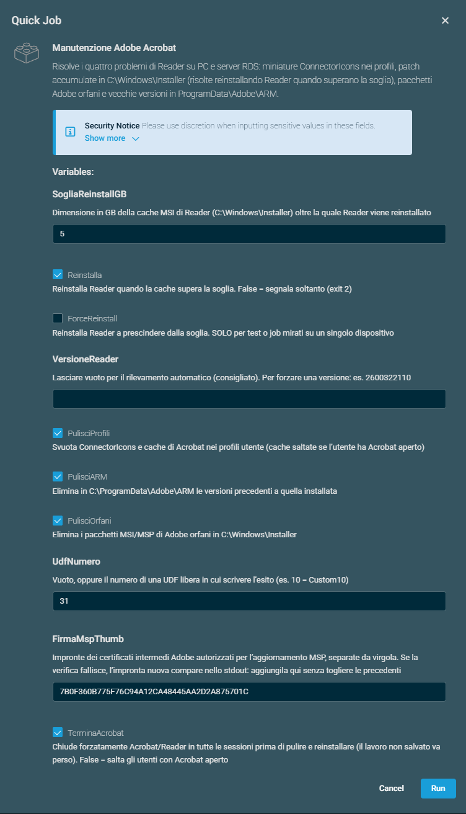
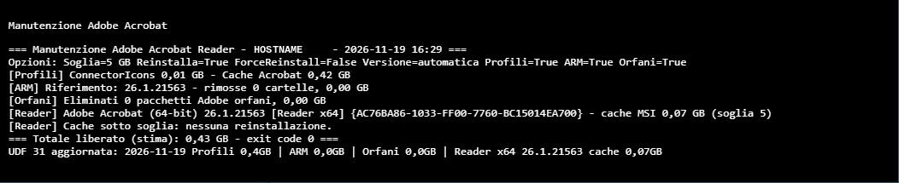
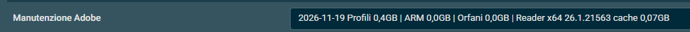

# Adobe-Reader-Maintenance

🇮🇹 [Versione italiana](README-ITALIAN.md)

PowerShell script that reclaims disk space taken by Adobe Acrobat Reader on Windows workstations and RDS servers. It can run **standalone**, as a **scheduled task**, or as a **Datto RMM component**.

> ⚠️ **Deletions are permanent, Acrobat/Reader is force-closed in all sessions (with `TerminaAcrobat=true`, unsaved work is lost) and the script can uninstall/reinstall Reader automatically.** Test on a single machine first and schedule it outside working hours.

## What it does

0. **Close Acrobat/Reader** (if `TerminaAcrobat=true`)
   - Force-closes Acrobat/Reader and its helper processes in all sessions, at startup and again right before the reinstallation. Open files prevent cleanup and uninstallation. The affected users are listed in the output.
1. **User profiles**
   - Empties `AppData\LocalLow\Adobe\Acrobat\DC\ConnectorIcons` (Adobe bug: thumbnails are never deleted and can grow to several GB per user).
   - Empties the Acrobat WebView2/AcroCef caches, **only for users who still have no Acrobat/Reader process running**.
2. **`C:\ProgramData\Adobe\ARM`**
   - Removes `Reader_*` / `Acrobat_*` folders of versions older than the installed one (all of them if no Acrobat/Reader is installed, neither registered nor on disk).
   - Removes `ARM\S` subfolders older than 30 days.
3. **Orphaned Adobe MSI/MSP in `C:\Windows\Installer`**
   - Deleted only if not referenced by any installed product **and** identified as Adobe Acrobat/Reader through their Summary Information. Files modified in the last 24 hours are skipped.
4. **Reader MSI cache (referenced patches)**
   - If the cache exceeds `SogliaReinstallGB` (or `ForceReinstall` is set), Reader is uninstalled and reinstalled: base MUI installer + latest update downloaded from `ardownload2.adobe.com`, with the **signature verified before uninstalling**: valid Authenticode signature, signing certificate issued to Adobe (`O=` field) and at least one intermediate/root certificate of the chain whose thumbprint is in the authorized list (`FirmaMspThumb`, `FirmaBaseX86Thumb`, `FirmaBaseX64Thumb`).
   - Only for Reader (x86 `7AD7` or unified x64 with `SCAPackageLevel=1`), a single installed product, no Acrobat window open, no MSI installation in progress, enough free disk space. Acrobat Standard/Pro is never touched.
   - Update version: `VersioneReader` if set, otherwise auto-detected from `armmf.adobe.com` (`current_version.txt`, win and mac manifests) with fallback to `VersioneRiserva`.

Products are detected from the Windows Installer registration (`Installer\UserData`), not from the `Uninstall` keys, which can be damaged.

## Requirements

- Windows 10/11 or Windows Server with **Windows PowerShell 5.1**.
- Run as **Administrator** or **SYSTEM**.
- For the reinstallation step: HTTPS access to `ardownload2.adobe.com` and `armmf.adobe.com` (the Datto RMM agent proxy is used automatically if configured).

## Configuration

All options are in the **CONFIGURAZIONE** block at the top of the script. Environment variables with the same name override the block values (this is how Datto RMM passes component variables).

| Variable | Type | Default | Description |
|---|---|---|---|
| `SogliaReinstallGB` | number | `5` | Reader MSI cache size (GB, in `C:\Windows\Installer`) above which Reader is reinstalled |
| `Reinstalla` | bool | `true` | Reinstall Reader when the cache exceeds the threshold. `false` = report only (exit 2) |
| `ForceReinstall` | bool | `false` | Reinstall Reader regardless of the threshold. **Testing or targeted jobs on a single device only** |
| `TerminaAcrobat` | bool | `true` | Force-close Acrobat/Reader in all sessions before cleaning and reinstalling (unsaved work is lost). `false` = skip users with Acrobat open and postpone the reinstallation |
| `VersioneReader` | string | empty | Empty = automatic detection (recommended). To force a version, e.g. `2600322110` |
| `VersioneRiserva` | string | `2600322110` | Fallback version used when automatic detection fails (script block only) |
| `PulisciProfili` | bool | `true` | Clean ConnectorIcons and Acrobat caches in user profiles |
| `PulisciARM` | bool | `true` | Clean `C:\ProgramData\Adobe\ARM` |
| `PulisciOrfani` | bool | `true` | Delete orphaned Adobe MSI/MSP packages in `C:\Windows\Installer` |
| `UdfNumero` | string | empty | Empty = no UDF write. Number of a free Datto RMM UDF to write the result to (e.g. `10` = `Custom10`) |
| `SpazioMinimoGB` | number | `3` | Minimum free space on the system drive required to reinstall (script block only) |
| `FirmaMspThumb` | string | `7B0F360B775F76C94A12CA48445AA2D2A875701C` | Authorized intermediate/root certificate thumbprints for the MSP update, comma-separated |
| `FirmaBaseX86Thumb` | string | `F8D2C10380EDA2774655E5619DB7D02F7D9E850A` | Authorized thumbprints for the x86 base installer (2015, Symantec Class 3 EV Code Signing CA) |
| `FirmaBaseX64Thumb` | string | `60EE3FC53D4BDFD1697AE5BEAE1CAB1C0F3AD4E3` | Authorized thumbprints for the x64 base installer (2021, DigiCert EV Code Signing CA) |

## Usage

### 1. Standalone

Edit the CONFIGURAZIONE block if needed, then from an **elevated** PowerShell:

```powershell
# Runs on: the target Windows machine, elevated Windows PowerShell 5.1
powershell.exe -NoProfile -ExecutionPolicy Bypass -File .\Adobe-Reader-Maintenance.ps1
echo $LASTEXITCODE
```

Tip: for a first run set `$Reinstalla = $false` to see what the script would do about the MSI cache without reinstalling.

> If environment variables named like the options exist on the machine (e.g. `Reinstalla`), they override the block values.

### 2. Scheduled task

Configure the toggles in the CONFIGURAZIONE block, copy the script to a folder **writable only by Administrators/SYSTEM** (the task runs as SYSTEM: a folder writable by users would allow privilege escalation), then register the task:

```powershell
# Runs on: the target Windows machine, elevated Windows PowerShell 5.1
$script = 'C:\Scripts\Adobe-Reader-Maintenance.ps1'
$log    = 'C:\Scripts\Logs\Adobe-Reader-Maintenance.log'
New-Item -ItemType Directory -Path (Split-Path $log) -Force | Out-Null

$action    = New-ScheduledTaskAction -Execute 'powershell.exe' `
             -Argument "-NoProfile -ExecutionPolicy Bypass -Command `"& '$script' *> '$log'; exit `$LASTEXITCODE`""
$trigger   = New-ScheduledTaskTrigger -Weekly -DaysOfWeek Sunday -At 3am
$principal = New-ScheduledTaskPrincipal -UserId 'SYSTEM' -LogonType ServiceAccount -RunLevel Highest
$settings  = New-ScheduledTaskSettingsSet -ExecutionTimeLimit (New-TimeSpan -Hours 2) -StartWhenAvailable

Register-ScheduledTask -TaskName 'Adobe Reader Maintenance' -Action $action -Trigger $trigger `
                       -Principal $principal -Settings $settings
```

The output of the last run is written to the log file; the exit code is visible in Task Scheduler ("Last Run Result").

### 3. Datto RMM component

1. Create a new component with script type **PowerShell** and paste the content of `Adobe-Reader-Maintenance.ps1`.
2. Add the following variables (the values in the CONFIGURAZIONE block are used for any variable that is not defined):

| Name | Type | Default value | Description |
|---|---|---|---|
| `SogliaReinstallGB` | String | `5` | Reader MSI cache size in GB (`C:\Windows\Installer`) above which Reader is reinstalled |
| `Reinstalla` | Boolean | `True` | Reinstall Reader when the cache exceeds the threshold. False = report only (exit 2) |
| `ForceReinstall` | Boolean | `False` | Reinstall Reader regardless of the threshold. ONLY for testing or targeted jobs on a single device |
| `VersioneReader` | String | *(empty)* | Leave empty for automatic detection (recommended). To force a version: e.g. `2600322110` |
| `PulisciProfili` | Boolean | `True` | Empty ConnectorIcons and Acrobat caches in user profiles (caches skipped if the user has Acrobat open) |
| `PulisciARM` | Boolean | `True` | Delete in `C:\ProgramData\Adobe\ARM` the versions older than the installed one |
| `PulisciOrfani` | Boolean | `True` | Delete orphaned Adobe MSI/MSP packages in `C:\Windows\Installer` |
| `UdfNumero` | String | `31` | Empty, or the number of a free UDF to write the result to (e.g. `10` = `Custom10`) |
| `FirmaMspThumb` | String | `7B0F360B775F76C94A12CA48445AA2D2A875701C` | Authorized Adobe intermediate certificate thumbprints for the MSP update, comma-separated. If verification fails, the new thumbprint is shown in the StdOut: add it here without removing the previous ones |
| `TerminaAcrobat` | Boolean | `True` | Force-close Acrobat/Reader in all sessions before cleaning and reinstalling (unsaved work is lost). False = skip users with Acrobat open |

`FirmaBaseX86Thumb` and `FirmaBaseX64Thumb` can be added as String variables too, but only if Adobe changes the certificate of the base installers.

Quick job / job launch window with the component variables:



3. Run it as a quick job on a test device, then schedule it as a job outside working hours.

Example job output (StdOut):



Result written to the UDF (here `Custom31`):



Notes:
- Datto RMM has supported up to 300 UDFs per device since the 2026 capacity increase; on tenants still limited to 30 UDFs use a value between 1 and 30.
- The UDF text is `yyyy-MM-dd` followed by a summary (freed space per section, Reader status, reinstallation result), truncated to 255 characters.
- Never enable `ForceReinstall` as a default on jobs targeting multiple devices.
- With `TerminaAcrobat=True` schedule the job outside working hours: users lose unsaved work in Acrobat/Reader.

## When Adobe changes certificate

If a new update is signed through a different intermediate certificate, the reinstallation is refused (exit 2, UDF `REINST: firma aggiornamento non autorizzata`) and the StdOut shows the chain found:

```
  Firma Adobe valida ma certificato intermedio non autorizzato. Catena trovata:
    Firma:      CN=Adobe Inc., O=Adobe Inc., ...
    Superiore:  CN=<new intermediate CA>  ->  <THUMBPRINT>
  Per autorizzarla aggiungi a FirmaMspThumb (separata da virgola): <THUMBPRINT>
```

Verify that the intermediate is a legitimate public CA, then **add** the thumbprint to `FirmaMspThumb` (component variable or script block) keeping the previous ones, e.g. `7B0F...701C,<THUMBPRINT>`. No script change is needed.

## Exit codes

| Code | Meaning |
|---|---|
| `0` | OK / nothing to do |
| `2` | Reinstallation needed but not performed (Reader still running, MSI busy, low disk space, download failure, unauthorized signature, `Reinstalla=false`, non-Reader product, multiple products) or an anomaly to check (e.g. Acrobat on disk but not registered) |
| `1` | Error (e.g. uninstall failed, Reader not installed after reinstall: **manual intervention required**) |

During reinstallation, logs are kept in `C:\Windows\Temp\AdobeReaderReinstall_<random>` (removed on success, kept on failure) and the last 25 lines are printed to the output.

## Safety measures

- Profile cleanup refuses to follow junctions/symlinks along the path, so a user cannot redirect a cache folder to a system path.
- Installers are downloaded into a folder with a random name and an ACL restricted to SYSTEM and Administrators, and the signature is verified before anything is uninstalled.
- Reinstallation is skipped if Acrobat/Reader is still running (after the forced close, if enabled) or a Windows Installer operation is running. Acrobat is checked again after the downloads, right before uninstalling.
- The signer is checked on the certificate `O=` field and the chain must contain an authorized thumbprint: a valid signature from another publisher is rejected.
- On RDS servers the script switches to install mode (`change user /install`) and back to execute mode.

## Disclaimer

Not affiliated with or endorsed by Adobe or Datto/Kaseya. Adobe, Acrobat and Reader are trademarks of Adobe Inc.; Datto RMM is a trademark of Kaseya. Base installer URLs and certificate thumbprints were taken from the Datto RMM "Adobe Acrobat/Reader installer" component. Use at your own risk.

## License

This project is licensed under the **GNU General Public License v3.0** (GPL-3.0-or-later). See [LICENSE](LICENSE).

## Author

[Leproide](https://github.com/Leproide)
